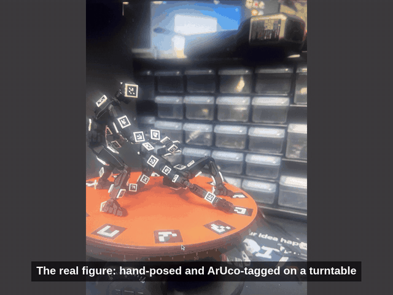
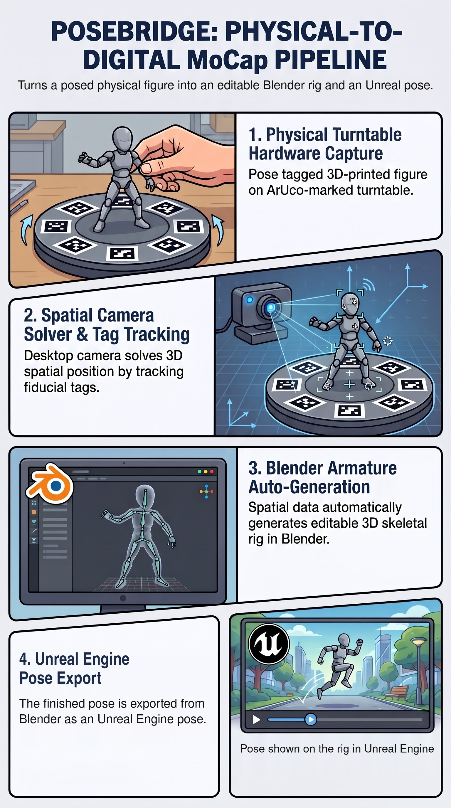
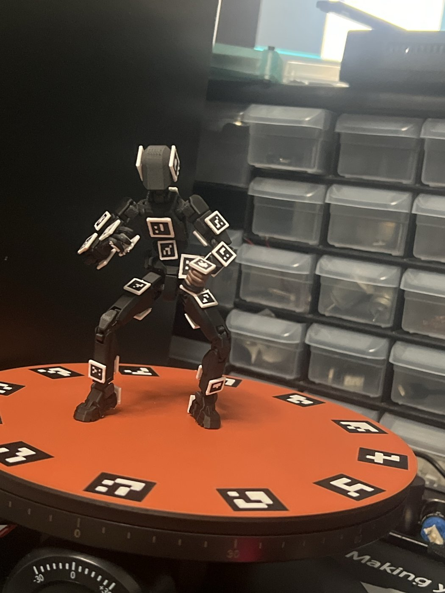
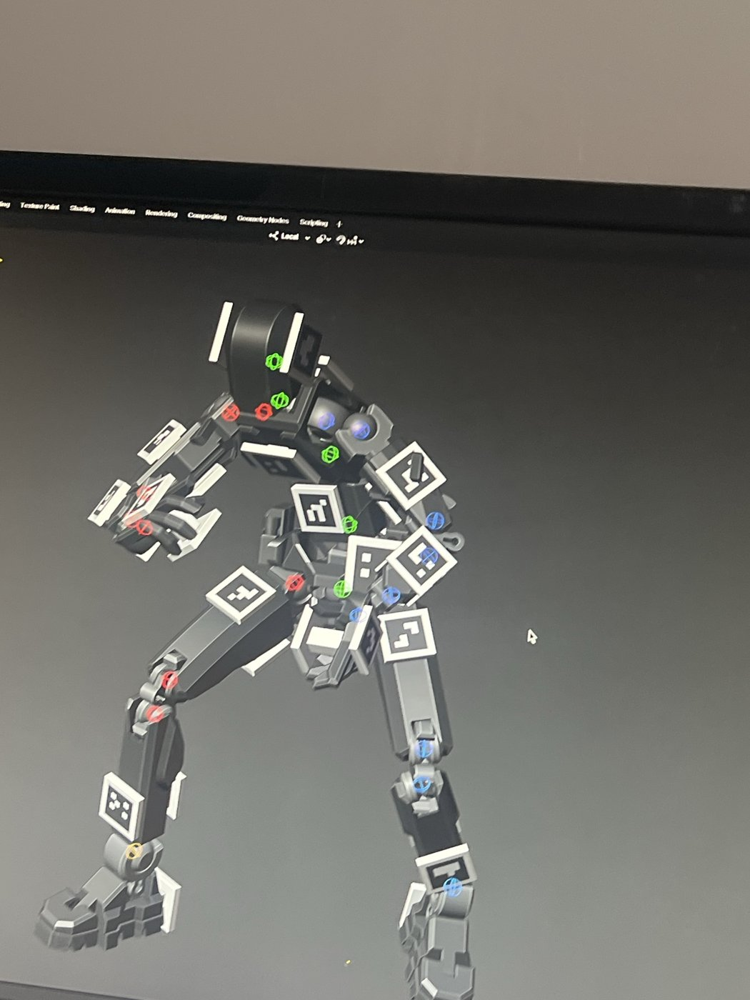
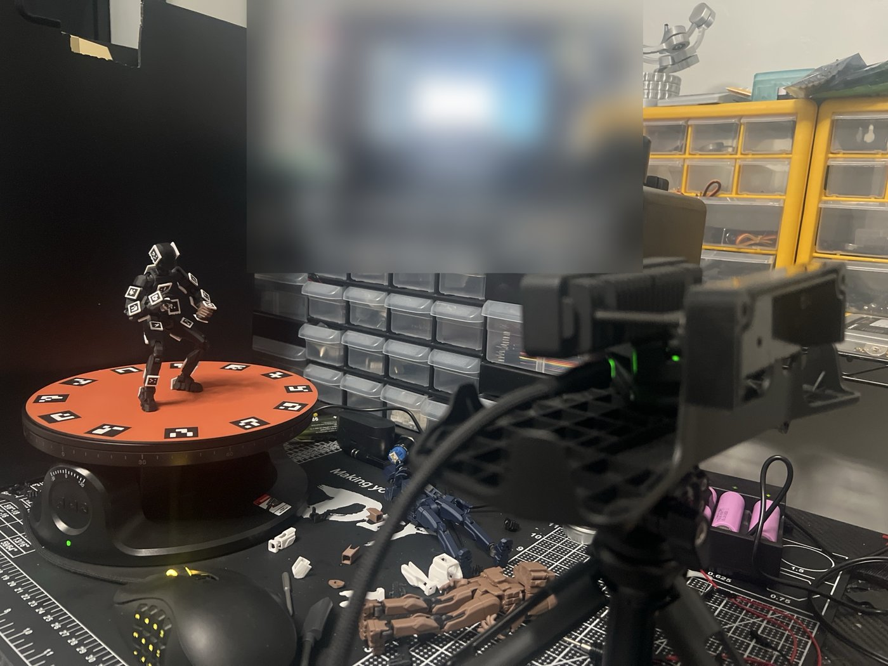

# PoseBridge

Pose a physical figure. Get an animation-ready digital pose.

*Real figure → solved Blender rig → animation. [Full clip](media/05-figure-to-animation.mp4)*

**Status:** working internal tool. This repository documents the project; source is currently private.

PoseBridge turns hand-posed figures into editable character poses. It tracks
square ArUco tags — the figure is just an armature that holds the tags in a
human-readable pose. Tags on each body segment and around the turntable let a
camera work out where every part is in 3D. PoseBridge solves the joint angles,
builds an editable rig in Blender, and exports the pose for Unreal Engine — a
desktop pose-capture workflow for animation blocking.

## What it does

- Captures a posed figure from multiple turntable angles with one camera
- Recovers each body segment's position from its tags
- Solves the full-body joint pose and builds an editable Blender rig
- Exports the pose to Unreal Engine
- Supports two figures in one capture
- Self-tested two ways: iterative tests that confirm each stage works as intended,
  and adversarial tests that try to break it on purpose (for example, inconsistent
  capitalization in lookup keys). Every break is fixed and kept as a regression test.

## Credits

Built with Python, OpenCV and Blender.
Figure: [Dummy 13 v1.0](https://www.printables.com/model/981111-dummy-13-version-10) by soozafone,
licensed under [CC BY 4.0](https://creativecommons.org/licenses/by/4.0/). ArUco tag mounts added by tardigraderesearch.

---
© 2026 tardigraderesearch. All rights reserved for original PoseBridge material. Third-party designs retain their respective licenses.
