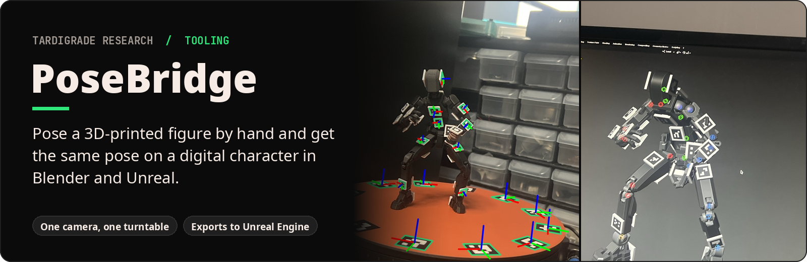

**What it is.** A desktop pose-capture tool for animators. The "controller" is a small 3D-printed posable figure.

**What it does.** You bend the figure into a pose and set it on a turntable. One camera reads the printed tags on every body part, and PoseBridge rebuilds that exact pose on an editable Blender rig, then exports it to Unreal Engine.

**Why it matters.** Blocking out a character pose with a mouse means rotating dozens of joints one by one. Posing a figure by hand takes seconds, and PoseBridge turns it into data an animator can use straight away.

*Real figure → solved Blender rig → animation. [Watch the clip (MP4)](media/05-figure-to-animation.mp4).*

The tags come from **[ArUco Tag Maker](https://github.com/tardigraderesearch/aruco-tag-maker)**, my open-source app for making named, 3D-printable camera markers.

## How it works

| 1. Pose the figure | 2. The camera finds every tag | 3. Editable rig in Blender |
|---|---|---|
|  |  |  |
| Printed tags sit on each body segment and around the turntable. | Each tag gives the position and rotation of the part it is stuck to. The coloured axes are real detections. | Joint angles are solved for the whole body and built into a rig an animator can keep editing, then exported to Unreal Engine. |

 <em>The capture setup: one camera, one turntable.</em>

## Highlights

- One ordinary camera; the turntable gives it views from every side.
- Recovers every body segment's position and rotation from its tags.
- Solves the full-body pose and builds an editable Blender rig.
- Exports the pose to Unreal Engine.
- Captures two figures in one session.
- Tested two ways: tests that confirm each stage does what it should, and adversarial tests that try to break it on purpose (for example, inconsistent capitalization in lookup keys). Every break found is fixed and kept as a regression test.

## Credits

Built with Python, OpenCV and Blender. Tags made with [ArUco Tag Maker](https://github.com/tardigraderesearch/aruco-tag-maker).
Figure: [Dummy 13 v1.0](https://www.printables.com/model/981111-dummy-13-version-10) by soozafone,
licensed under [CC BY 4.0](https://creativecommons.org/licenses/by/4.0/). ArUco tag mounts added by tardigraderesearch.

This repository is a project showcase; the PoseBridge source code is kept private.

---
© 2026 tardigraderesearch. All rights reserved for original PoseBridge material. Third-party designs retain their respective licenses.
